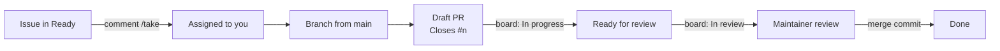

# Contributing to THD Room Finder

THD Room Finder is an open-source (GPL-3.0) student project that helps people at
Technische Hochschule Deggendorf find a free room, and, from Phase 1 on, focus
in it alone or with their batch. Contributions of code, design, research and
documentation are welcome. Forks are allowed by the license; improvements sent
back upstream reach every THD student.

This page is the short version. The details live in
[`docs/contributing/`](docs/contributing/README.md).

## Contributing from the THD AI fork

Use the [shared discussions](https://github.com/arudaev/THD-Room-Finder/discussions)
for questions and ideas, and the
[upstream issue tracker](https://github.com/arudaev/THD-Room-Finder/issues)
for bugs and agreed work. The
[project board](https://github.com/users/arudaev/projects/8/views/1) and its
[Completed view](https://github.com/users/arudaev/projects/8/views/3) show the
same live records for everyone coming from either repository.

You can develop a branch in `THD-AI/THD-Room-Finder` and open a pull request
into `arudaev/THD-Room-Finder:main`. If students review a change in the fork
first, link that review in the upstream pull request. Reference upstream issues
with the full name, for example `Refs arudaev/THD-Room-Finder#123`, so a fork's
local issue numbers cannot point to different work.

Fork administration changes can be reviewed locally. Shared product bugs,
feature requests and conversations belong upstream; there is no bot copying
comments, authors or status between repositories. The native Issues tab cannot
be configured as a redirect, so this fork's issue chooser provides direct links
to the shared destinations. GitHub's Projects tab only lists projects owned by
the same user or organisation as the repository; use the shared board link above.

## Five-minute setup

Requires Node 20+.

```bash
git clone https://github.com/THD-AI/THD-Room-Finder.git
cd THD-Room-Finder
git remote add upstream https://github.com/arudaev/THD-Room-Finder.git
git fetch upstream
npm install
npm run dev          # http://localhost:5173, live THabella data through a dev proxy
```

Before every push: `npm run typecheck && npm test && npm run build`.
Android, Supabase and release setup are in
[docs/development](docs/development/README.md).

## How work flows



1. **Pick an issue.** Look at the **Ready** column of the
   [project board](https://github.com/users/arudaev/projects/8), or filter by
   [`good first issue`](https://github.com/arudaev/THD-Room-Finder/labels/good%20first%20issue).
   Comment **`/take`** to assign yourself (**`/drop`** to let it go). Epics
   are not taken directly; take one of their sub-issues.
2. **Branch from `main`:** `feature/<issue>-<slug>`, `fix/…`, `docs/…` or
   `chore/…`. The `/take` reply suggests a name.
3. **Open a draft PR early** with `Closes #<issue>` in the description. The
   board moves the card for you.
4. **Mark it ready for review** when the acceptance criteria are met and the
   checks pass. The maintainer reviews and merges with a merge commit, so
   every commit you made lands on `main` and counts on your GitHub profile.

No issue for what you want to do? Start a
[discussion](https://github.com/arudaev/THD-Room-Finder/discussions) or open
an issue with one of the forms. The maintainer triages it into a milestone.

## Rules that keep `main` releasable

| Rule | Why |
|---|---|
| PR titles follow [Conventional Commits](https://www.conventionalcommits.org/) (`feat(focus): start a private session`), at most 72 characters | The title becomes the merge commit's title on `main`; CI checks it |
| Commit messages inside the PR also follow Conventional Commits | They land on `main` unchanged |
| Every PR links an issue (`Closes #n` or `Refs #n`) | Traceability and automatic board updates; CI checks it |
| One issue per PR; dependent work may form a [native stack](docs/contributing/workflow.md#stacked-pull-requests) | Small, reviewable diffs |
| Business rules go in `src/domain/` with a Vitest test | The domain layer is the trusted core |
| Style with design tokens, never hard-coded colours; strings via `t(en, de)` | One design system, two languages |
| Never translate room or building codes (`A.011`, `ITC1.07`) | They are identifiers |
| Design changes go through [Claude Design](design/README.md) first | Keeps design and code in sync |
| No secrets, real student data or production credentials in commits, issues or previews | Privacy |

Commits are authored by the person who wrote them. Do not add AI co-author
trailers or "generated with" lines to commits or PRs.

## For maintainers and AI agents

[Discussions](docs/contributing/discussions.md) covers the categories and when
a conversation becomes an issue.

[AGENTS.md](AGENTS.md) and [CLAUDE.md](CLAUDE.md) hold the agent rules: agents
open PRs but never merge, enable auto-merge, force-push shared branches or
publish releases.

## More

- [Workflow in detail](docs/contributing/workflow.md): issue lifecycle, stacks, reviews
- [Writing good issues](docs/contributing/writing-issues.md): epics, stories, tasks, bugs, spikes
- [Project board](docs/contributing/project-board.md): views, fields and automation
- [Code of conduct](CODE_OF_CONDUCT.md) · [Security policy](SECURITY.md)
